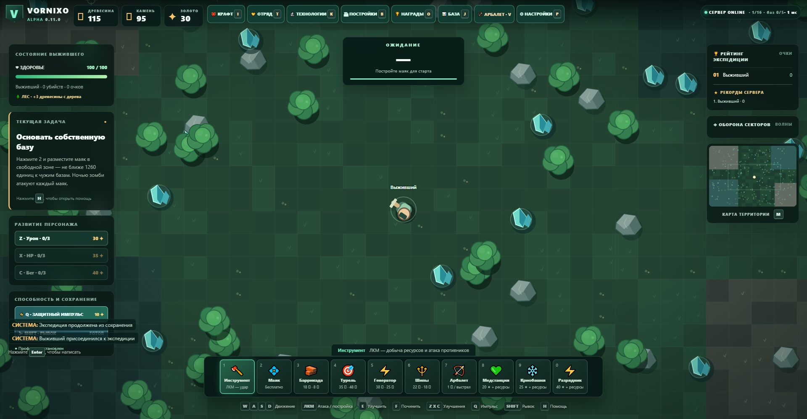
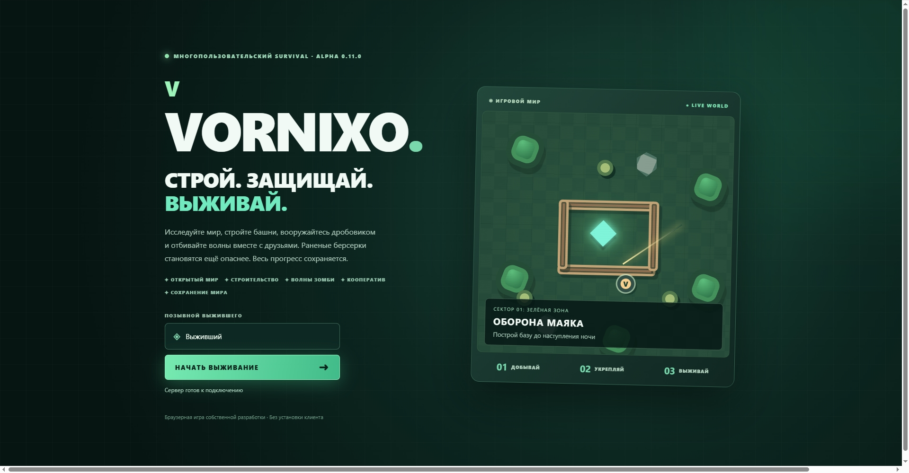

<div align="center">

<p></p>

<p></p>

<h1>VORNIXO</h1>

<p><strong>СТРОЙ · ЗАЩИЩАЙ · ВЫЖИВАЙ</strong></p>

<p>Многопользовательская браузерная Survival-игра о строительстве базы,<br /> добыче ресурсов и обороне от волн зомби.</p>

<p>
  <a href="https://github.com/Zeihos/Vornixo"></a>
  <a href="https://github.com/Zeihos/Vornixo/actions/workflows/ci.yml"></a>
  <a href="https://nodejs.org/"></a>
</p>

<p>
  <a href="#об-игре">Об игре</a> ·
  <a href="#возможности">Возможности</a> ·
  <a href="#скриншоты">Скриншоты</a> ·
  <a href="#быстрый-старт">Начать играть</a> ·
  <a href="docs/ROADMAP.md">План разработки</a>
</p>

<p>
  <a href="https://vk.ru/vornixo">Сообщество ВКонтакте</a> ·
  <a href="https://github.com/Zeihos/Vornixo/issues/new/choose">Сообщить об ошибке</a> ·
  <a href="https://github.com/Zeihos/Vornixo/actions/workflows/ci.yml">Сборки GitHub Actions</a>
</p>

</div>

---

## Об игре

В **VORNIXO** каждый день — возможность подготовить оборону, а каждая ночь — испытание на прочность. Исследуйте мир, собирайте древесину и камень, укрепляйте базу, ставьте защитные сооружения и отбивайтесь от всё более опасных противников.

Играть можно одному или вместе с друзьями. **У каждой базы свои волны нападений:** оборона приостанавливается, если все её защитники вышли из игры.

> **Текущий статус — Alpha 0.18.0.** Игра находится в активной разработке. Это рабочий прототип для локальных и закрытых тестов, **не завершённый публичный релиз 1.0**.

## Возможности

| | |
|:--|:--|
| 🌲 **Открытый мир** | Исследование карты, биомы, древесина, камень и другие ресурсы |
| 🏰 **Собственная база** | Строительство, укрепления, башни и улучшения |
| 🧟 **Ночные волны** | Разные типы зомби, боссы и возрастающая сложность |
| ⚔️ **Выживание и бой** | Арбалет, дробовик, навыки и специальные способности |
| 🧪 **Крафт и технологии** | Создание предметов, исследования и развитие |
| 🤝 **Совместная игра** | Отряды, командный чат и обмен ресурсами |
| 🏆 **Прогресс** | Профили игроков, достижения, рекорды и сохранения |

## Скриншоты

<table>
  <tr>
    <td width="50%" valign="top">
      
      <sub><strong>Игровой экран</strong> — Alpha 0.11.0</sub>
    </td>
    <td width="50%" valign="top">
      
      <sub><strong>Веб-интерфейс</strong> — Alpha 0.11.0</sub>
    </td>
  </tr>
</table>

<sub>Изображения демонстрируют предыдущую альфа-версию. В текущей версии интерфейс может отличаться.</sub>

## Быстрый старт

Для локального запуска потребуется **[Node.js 22 или новее](https://nodejs.org/)**. Дополнительные npm-пакеты устанавливать не нужно.

**Windows:**

1. Скачайте репозиторий через **Code → Download ZIP** или выполните команду <code>git clone https://github.com/Zeihos/Vornixo.git</code>.
2. Распакуйте ZIP, если скачивали архив.
3. Запустите **<code>START_WINDOWS.bat</code>** в папке проекта.
4. Откройте **http://127.0.0.1:3000**.

**Windows, Linux и macOS через терминал:**

```bash
git clone https://github.com/Zeihos/Vornixo.git
cd Vornixo
npm start
```

Затем перейдите по адресу **http://127.0.0.1:3000**.

> **Важно:** локальный сервер и публичный игровой сервис — разные вещи. Не открывайте сервер в интернет без HTTPS/WSS, настройки доступа, резервного копирования и отдельного тестирования безопасности.

<details>
<summary><strong>🎮 Основные клавиши</strong></summary>

| Клавиша | Действие |
|:--|:--|
| <code>W A S D</code> | Движение |
| <code>Shift</code> | Рывок |
| <code>Q</code> | Защитный импульс |
| <code>I</code> | Крафт |
| <code>T</code> | Отряд |
| <code>B</code> | Дополнительные постройки |
| <code>K</code> | Исследования |
| <code>O</code> | Достижения |
| <code>J</code> | Статистика базы |
| <code>V</code> | Смена оружия |
| <code>M</code> | Мини-карта |
| <code>P</code> | Настройки |

</details>

<details>
<summary><strong>🛠 Для разработки и тестирования</strong></summary>

```bash
npm test
npm run build:clean
```

- <code>server.js</code> — сервер игры на Node.js.
- <code>public/</code> — клиент для браузера (HTML, CSS, JavaScript).
- <code>tests/</code> — базовые автоматические проверки.
- <code>scripts/</code> — сборка чистого архива.
- <code>assets/</code> — графика и материалы сообщества.
- <code>docs/</code> — скриншоты и план разработки.

После <code>npm run build:clean</code> готовый архив появится в <code>dist/</code>. В нём **только игра** — без README, тестов и файлов разработки.

</details>

## Разработка и будущие обновления

| Этап | Состояние |
|:--|:--|
| **Alpha 0.14.0** — независимые базы, волны, кооператив и сохранения | ✅ Реализовано |
| **Alpha 0.15.0** — экономная синхронизация ресурсов и улучшенный выбор целей зомби | ✅ Реализовано |
| **Alpha 0.16.0** — переподключение и освобождение зависших соединений | ✅ Реализовано |
| **Alpha 0.17.0** — контроль сетевой очереди и показатели производительности | ✅ Реализовано |
| **Alpha 0.18.0** — безопасные резервные копии и сохранение при выходе | ✅ Реализовано |
| **Beta** — тесты с реальными игроками и баланс | 📋 Запланировано |
| **Release 1.0** — публичный запуск после проверки качества | 📋 Запланировано |

Подробности — в **[дорожной карте VORNIXO](docs/ROADMAP.md)**.

## Проверки и чистые сборки

Каждое изменение в <code>main</code> проходит проверки **GitHub Actions**. Автоматически запускаются синтаксические тесты, проверка сервера и создание чистого ZIP-архива. Состояние последней проверки можно посмотреть по значку наверху страницы.

**[Открыть GitHub Actions и найти последнюю сборку](https://github.com/Zeihos/Vornixo/actions/workflows/ci.yml)**

## Для разработчиков и администраторов

- **[Как помочь проекту](CONTRIBUTING.md)** — правила разработки, проверки и оформления Pull Request.
- **[Безопасность](SECURITY.md)** — как сообщить об уязвимости и защитить данные игроков.
- **[Запуск и обслуживание](docs/OPERATIONS.md)** — сеть, порт, обновление и резервные копии.

## Обратная связь

Нашли баг или придумали улучшение? Откройте **[Issues](https://github.com/Zeihos/Vornixo/issues/new/choose)** и выберите подходящий шаблон. Для сообщения о проблеме желательно приложить версию игры, действия для воспроизведения и лог без личных данных.

Следите за развитием игры в **[сообществе VORNIXO ВКонтакте](https://vk.ru/vornixo)**.

<details>
<summary><strong>Безопасность данных и использование исходников</strong></summary>

- Перед обновлением игры обязательно создавайте резервную копию папки <code>data/</code>.
- Никогда не публикуйте аккаунты, токены, пароли и содержимое <code>data/</code>.
- В истории ранних коммитов могли остаться старые сохранения; удаление файлов из актуальной ветки не очищает историю Git.
- Публичная доступность исходного кода **не означает автоматического разрешения** копировать, перераспространять или использовать его в чужих проектах. Отдельная лицензия пока не задана.

</details>

---

<div align="center">

<h3>VORNIXO</h3>

<p><strong>Каждая ночь может стать последней.</strong></p>

<p><a href="https://vk.ru/vornixo">ВКонтакте</a> · <a href="https://github.com/Zeihos/Vornixo">Исходный код</a> · <a href="https://github.com/Zeihos/Vornixo/issues/new/choose">Сообщить о баге</a></p>

</div>
